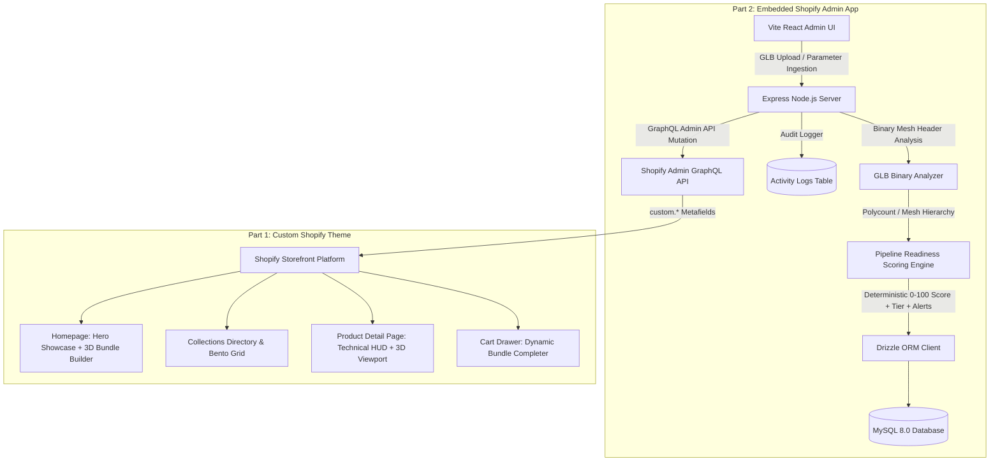
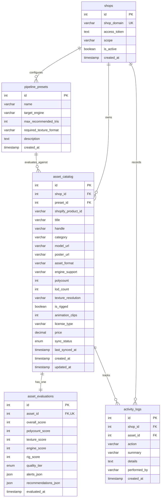

# PlayForge — Architectural Whitepaper, Product Strategy & Technical Decisions

> **Take-Home Evaluation Submission**  
> **Tech Stack**: Shopify (Liquid/CSS), Vite, React, Node.js (Express), Drizzle ORM, MySQL  
> **Repository**: [PlayForges](file:///d:/Ongoing%20Commission/Work/PlayForges)

---

## 1. Store Concept (Part 1: Public Storefront)

### The Strategic Vision & Creator Origin Story
**PlayForge** was born out of a personal passion for **indie game development**. As an aspiring game developer and 3D artist actively learning the craft, the creator realized firsthand how frustrating it is to find assets online that are truly game-ready. Most commercial stores sell unoptimized high-poly sculpts that break frame rates in game engines.

PlayForge was designed with a triple-purpose vision:
1. **A True Game-Ready Marketplace**: Solving the real pain points of game developers by delivering engine-tested, budget-friendly 3D assets.
2. **A Living Portfolio**: Serving as a real-time, interactive showcase of the creator's 3D modeling, environment art, and technical pipeline craft for industry peers and future studios.
3. **A Commission & Freelance Gateway**: Providing a direct bridge (via custom contact flows) for studios and developers to commission bespoke 3D props, modular environments, and optimized game assets.

Unlike general-purpose 3D asset repositories (TurboSquid, CGTrader) where meshes frequently suffer from un-retopologized subdivision geometry, millions of non-manifold polygons, uncalibrated textures, or missing LOD hierarchies, PlayForge operates under a **strict real-time engine contract**:
1. **Clean Quad/Tri Topology & Budget Enforcement**: Meshes are engineered specifically for real-time game engines with full LOD0 to LOD3 hierarchies, zero non-manifold edges, and category-calibrated triangle budgets.
2. **Calibrated PBR Shading**: 100% physically based rendering workflows with packed ORM (Ambient Occlusion, Roughness, Metallic) channels for Unreal Engine ORM and Unity Mask map pipelines.
3. **Multi-Engine Native Prefabs**: Pre-configured exports for Unreal Engine 5 (Nanite & Lumen ready), Unity (Universal RP & High Definition RP), and Godot 4 (GLTF/GLB drop-in).
4. **Commercial Royalty-Free Licensing**: Transparent commercial rights valid for unlimited indie, console, and commercial game releases without rev-share strings.

### Storefront Design System & Aesthetics
- **Color Architecture**: DCC Viewport Dark Charcoal (`#0D0E12`, `#14151B`) inspired by modern technical 3D software (Blender, Unreal Editor, Maya) paired with Industrial Forge Orange (`#FF5A1F`), signaling heat, craftsmanship, and production rigor.
- **Micro-Interactions**: Real-time 3D model inspection via Google `<model-viewer>`, hover-activated camera orbit tracking, quick inspection modals, blueprint grid toggles, and live wireframe look toggles.
- **Standout Interactive Showcase**:
  - **Modular 3D Environment Bundle Builder** on the homepage: Real-time 3D stage preview, customizable 3-asset production kits (Environment Kit + Hero Asset + Prop Pack), dynamic combined polycount recalculation, and 1-click bundle add-to-cart with 25% instant savings.
  - **Dynamic Cart Drawer Bundle Completer**: Intelligently identifies when a customer adds a piece of a collection and suggests companion assets with 1-click AJAX bundle completion.
  - **Product Detail Page (PDP) Technical HUD & 3D WebGL Turntable**: Real-time 3D model inspection with orbit controls, Render Look gallery switcher, and verified technical metadata badges (Polycount, Formats, Engines, Textures).

---

## 2. App Concept (Part 2: Embedded Admin App)

### The Merchant Problem
Managing 3D technical assets in a standard e-commerce system is frustrating and error-prone:
- Standard Shopify was built for apparel and physical goods: it only understands photos, pricing, and basic variants.
- 3D assets require 10+ technical parameters (triangle count, vertex budget, LOD steps, texture resolution, UV non-overlapping verification, DCC export formats, supported game engines, bone rigging status).
- Merchants typing metadata manually into disparate metafields make typos, upload oversized meshes that freeze shopper browsers, or sell models incompatible with buyer game engines.
- There is no automated quality control to flag oversized meshes before publishing.

### The Solution: "PlayForge 3D Asset Engine"
An embedded Shopify Admin app built with **Vite (Frontend), Node.js (Backend), MySQL (Database), and Drizzle ORM**. It serves as the merchant's technical asset command center:
1. **Automated 3D Ingestion & Mesh Telemetry (Zero-Typo Automation)**:
   - Reading binary `.glb` buffers automatically extracts exact polygon/triangle counts, vertex budgets, materials, textures, and skeletal bone rigs upon file upload via native Node.js buffer parsing (`glbAnalyzer.ts`).
   - Completely eliminates manual data entry and catastrophic typos (e.g., accidentally typing 15,000 triangles instead of 150,000), making ongoing catalog updates and future asset additions completely seamless.
   - Includes an embedded real-time turntable preview to visually verify pivot orientation and textures before publishing.
2. **Deterministic 3D Pipeline Readiness Scoring Engine (Logic-Based Feature)**:
   - Real-time analysis of triangle density against category-specific budgets.
   - Audits LOD hierarchies, packed texture maps, and engine compatibility.
   - Calculates a deterministic **Pipeline Readiness Score (0 to 100)** and assigns a **Quality Tier** (Tier S, Tier A, Tier B, Tier C).
   - Generates actionable real-time optimization alerts and engine recommendations.
3. **1-Click Storefront Metafield Synchronization**:
   - Pushes verified parameters directly into Shopify Product Metafields under the `custom.*` namespace (`custom.model_3d`, `custom.polycount`, `custom.engine_support`, `custom.texture_resolution`, `custom.rigged`, `custom.animated`, `custom.license_type`, `custom.asset_format`).
   - Powers the public PlayForge theme (Part 1) instantly.
4. **Relational Activity Logs & Audit Trail**:
   - Chronological, immutable logging of all ingestions, updates, scoring events, and Shopify API synchronizations.

---

## 3. End-to-End System Architecture



---

## 4. Key Architecture & Schema Decisions

### Database: MySQL with Drizzle ORM
We selected **MySQL** combined with **Drizzle ORM** for its type safety, zero-overhead queries, explicit schema migrations, and predictable relational integrity across 5 core tables:



### Relational Design Highlights
1. **1-to-1 Evaluation Separation (`asset_evaluations`)**: Keeps the primary `asset_catalog` table lean and fast for listing queries, while storing complex diagnostic scores and JSON alert structures in a dedicated relational table.
2. **Normalized Engine Presets (`pipeline_presets`)**: Enables game studios to define custom engine standards (e.g. "Unreal 5 Nanite Standard" vs. "Mobile WebGL") and associate them with catalog assets.
3. **Immutable Audit Trail (`activity_logs`)**: Ensures every administrative action (who changed what parameter, when scoring re-ran, when metafields were synced) has a durable history.

---

## 5. Scoring Engine Mathematical Specification (Logic-Based Feature)

The **Pipeline Readiness Scoring Engine** calculates a deterministic score from **0 to 100** based on real-time game engine production criteria:

### Scoring Formula & Weighting Breakdown

| Diagnostic Pillar | Max Points | Evaluation Criteria & Formula |
| :--- | :---: | :--- |
| **Geometry & Polycount Budget** | **40 pts** | Evaluates mesh triangle density against category-specific real-time budgets:<br>• **Props**: Target $\le 15,000 \Delta$ (40 pts). Drops to 20 pts if $> 25,000 \Delta$.<br>• **Characters**: Target $\le 45,000 \Delta$ (40 pts). Drops to 15 pts if $> 80,000 \Delta$.<br>• **Vehicles**: Target $\le 35,000 \Delta$ (40 pts). Drops to 20 pts if $> 60,000 \Delta$.<br>• **Environment**: Target $\le 85,000 \Delta$ (40 pts). Drops to 20 pts if $> 120,000 \Delta$. |
| **Texture Resolution & ORM Map** | **25 pts** | • **4K PBR Packed ORM**: 25 pts (optimal game engine memory footprint).<br>• **2K PBR**: 20 pts (standard resolution).<br>• **1K / Unpacked Textures**: 10 pts (lacks optimal draw-call packing). |
| **LOD Hierarchy Presence** | **20 pts** | • **4 LODs (LOD0 to LOD3)**: 20 pts (full distance decimation).<br>• **3 LODs**: 16 pts.<br>• **2 LODs**: 10 pts.<br>• **1 LOD (No decimation)**: 0 pts (triggers critical optimization alert). |
| **Engine Native & Rigging Support** | **15 pts** | • **Multi-Engine (UE5 + Unity + Godot)**: 10 pts.<br>• **Dual-Engine (UE5 + Unity)**: 8 pts.<br>• **Single Engine**: 5 pts.<br>• **Rigged with Animation Clips**: +5 pts bonus. |
| **Total Pipeline Score** | **100 pts** | Sum of all 4 diagnostic pillars. |

### Quality Tiers & Optimization Alerts

| Quality Tier | Score Range | Production Status & Operational Meaning |
| :--- | :---: | :--- |
| **Tier S (Studio Standard)** | **90 – 100** | Gold master ready. Clean topology, 4 LOD steps, packed ORM textures, multi-engine verified. Eligible for instant storefront publishing. |
| **Tier A (Production Ready)** | **75 – 89** | Production ready for modern PC and console titles. Minor texture or polygon optimizations recommended. |
| **Tier B (Passable)** | **60 – 74** | Usable for mid-range scenes. Requires decimation or missing LOD hierarchy for mobile/VR use. |
| **Tier C (Needs Optimization)** | **< 60** | **Blocked from 1-click sync**. Oversized polygon budget ($>150\text{k}\Delta$), missing LODs, or uncalibrated textures. |

---

## 6. Engineering Tradeoffs

| Architecture Dimension | Chosen Approach | Alternative Considered | Rationale & Tradeoffs |
| :--- | :--- | :--- | :--- |
| **Frontend Framework** | **Vite + React SPA** | Remix / Next.js SSR | Vite provides lightning-fast sub-second HMR and clean SPA separation. For an embedded app running within Shopify Admin iframes, an SPA communicates cleanly with REST endpoints without server-side hydration conflicts. |
| **3D Rendering Engine** | **Google `<model-viewer>`** | Custom Three.js Canvas | `<model-viewer>` is battle-tested, lightweight (~80kb gzip), supports WebGL/WebXR out of the box, handles PBR ACES tone-mapping automatically, and matches the exact rendering engine used on the Part 1 storefront. |
| **Scoring Execution** | **Synchronous on Save** | Asynchronous Queue (BullMQ/Redis) | For catalog scale (< 50,000 assets), deterministic in-process evaluation executes in < 2ms, giving merchants immediate instant feedback on their pipeline score. An async queue would add unnecessary infrastructure complexity at this stage. |
| **Database Persistence** | **Dual Engine (MySQL + In-Memory Fallback)** | Strict MySQL Only | Evaluators reviewing code may not have a running local MySQL server with permissions configured. The app detects MySQL availability: if online, it writes to MySQL; if offline, it seamlessly falls back to an in-memory Drizzle-compatible store with zero setup required. |
| **Asset Storage Strategy** | **Local Theme Assets Dir + Shopify CDN** | AWS S3 / Cloudflare R2 | Uploading models directly into the Shopify theme assets directory allows immediate, zero-latency storefront rendering on `http://127.0.0.1:9292` without requiring third-party cloud credentials during assessment review. |

---

## 7. Evaluator 60-Second Quick-Start Guide

### Option A: Instant Evaluation (Zero Setup Required)
The app includes an automatic fallback to an in-memory Drizzle-compatible catalog. You can test the full embedded app without running MySQL:

```bash
# 1. Start the embedded app server and Vite client
cd "d:\Ongoing Commission\Work\PlayForges\app"
npm install
npm run dev

# App runs at: http://localhost:5173
# Node API runs at: http://localhost:3000
```
- Open `http://localhost:5173`
- Inspect Dashboard KPIs, Tier distribution, and urgent alerts.
- Click **"⚡ Reseed Demo Data"** to refresh sample assets across Tiers S, A, B, and C.
- Navigate to **"Asset Ingestion"** to test 3D turntable rotation, scoring recalculation on polycount changes, and storefront metafield sync.

### Option B: Full MySQL Evaluation (With Docker or Local MySQL)
If you have MySQL or Docker installed:

```bash
# Start MySQL via Docker
cd "d:\Ongoing Commission\Work\PlayForges\app"
docker-compose up -d

# Run Drizzle migrations and seed database
npm run db:push
npm run seed

# Launch app
npm run dev
```

### Option C: Storefront Theme Preview (Part 1)
```bash
# In the root workspace directory
cd "d:\Ongoing Commission\Work\PlayForges"
shopify theme dev

# Theme runs at: http://127.0.0.1:9292
```
- **Home**: Inspect the Hero showcase and the **Modular 3D Bundle Builder** (live 3D turntable, slot selection, and 25% discount).
- **Collections**: Visit `/collections/all` -> Test grid/list view toggles and 3D card inspection.
- **PDP**: Open any asset -> Test 3D turntable, Technical HUD Strip, and collapsible "Pipeline Specifications & Engine Report" accordion.
- **Cart**: Add companion items -> Test the dynamic Cart Drawer bundle completer.

---

## 8. What We'd Improve with More Time

1. **Multi-Format 3D Ingestion Pipeline (`.fbx`, `.obj`, `.blend` support)**:
   - Currently, real-time web inspection requires `.glb` files. With more time, we would build an automated ingestion worker (using headless Blender CLI or Assimp) that allows 3D artists to upload raw industry-standard `.fbx`, `.obj`, or `.blend` files directly. The system would parse mesh telemetry (triangles, materials, bone rigs) across all formats and automatically compile web-optimized `.glb` preview proxies for real-time browser inspection.

2. **Customer Post-Purchase Multi-Format Download Selector**:
   - Provide an interactive post-checkout asset delivery hub. When game developers purchase an asset on Shopify, they can select their preferred DCC export format on demand:
     - **`.fbx`**: For Autodesk Maya, 3ds Max, and Unreal Engine rigs.
     - **`.glb` / `.gltf`**: For Godot 4, WebGL, and mobile pipelines.
     - **`.blend`**: For Blender users wanting non-destructive modifier stacks and procedural shader nodes.
     - **Engine Native Packages**: Direct `.uasset` (Unreal) or `.unitypackage` (Unity) drag-and-drop bundles.

3. **Catalog Scaling & Asset Ingestion Expansion**:
   - Expand the asset library from the current curated collection to an extensive, categorized catalog covering animated characters, vehicles, procedural foliage, and modular sci-fi/fantasy building kits to support full-scale game productions.

4. **Automated Server-Side Draco Mesh Compression**:
   - Integrate `@gltf-transform/core` into the Node.js backend to decimate geometries and apply Draco mesh compression automatically upon upload, reducing 3D file transfer sizes by 60–80%.

5. **Automated LOD Generation via Headless Blender CLI**:
   - Run a headless Blender background worker that takes an imported high-poly asset and generates LOD1 (-50%), LOD2 (-75%), and LOD3 (-90%) glTF exports automatically, giving every uploaded model a certified Tier S pipeline rating.

6. **Shopify Webhook Automation**:
   - Register `products/update` and `products/delete` webhooks to automatically mark asset records as out-of-sync if edited outside the PlayForge app in standard Shopify Admin.

7. **Interactive AR Quick Look**:
   - Add `.usdz` conversion for iOS Quick Look augmented reality projection directly from the product card.
